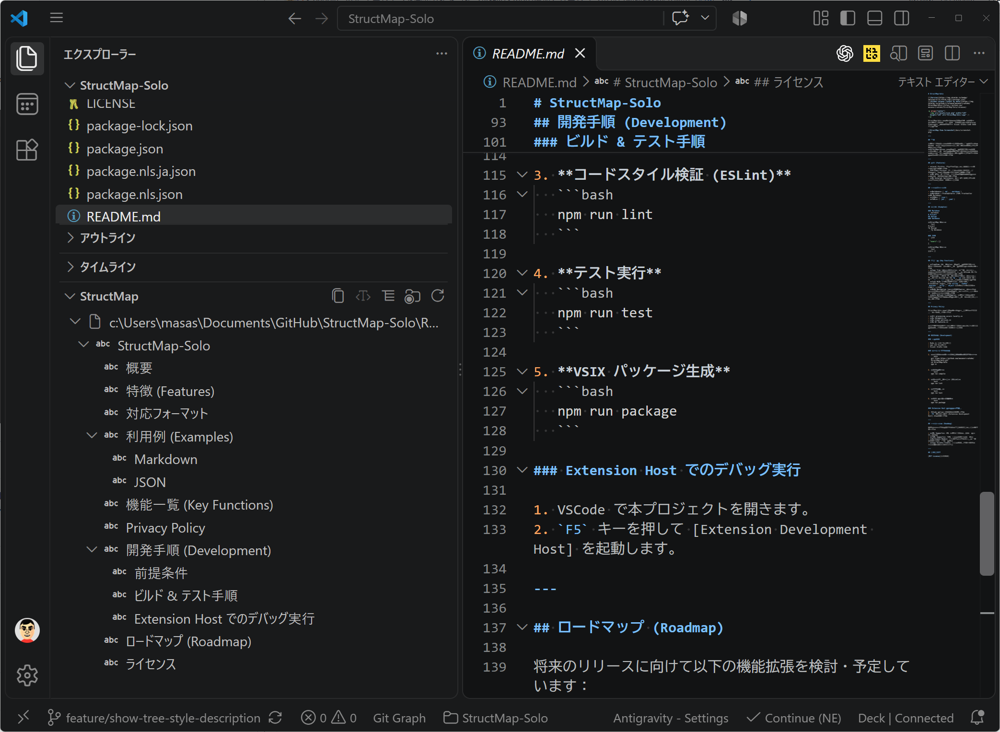

# StructMap-Solo

[](package.json)
[](https://marketplace.visualstudio.com/items?itemName=masanori-satake.structmap-solo)
[](https://open-vsx.org/extension/masanori-satake/structmap-solo)
[](https://github.com/masanori-satake/StructMap-Solo/releases)

<p align="center">
  <strong>Language / 言語:</strong> <a href="#english">English</a> | <a href="#japanese">日本語</a>
</p>

---

<a id="english"></a>
## English

**StructMap-Solo** is a lightweight, 100% local VS Code extension that intuitively visualizes the document and hierarchical structure of Markdown, JSON, YAML, XML, TOML, and JSON Schema files directly in your Explorer View sidebar.

As documents and configuration files grow larger and more complex, understanding their overall structure and accessing specific nodes or headings becomes challenging. StructMap-Solo parses the active file in real time, enabling you to interactively view and navigate object trees and document outlines without AI or any external services.



---

### 📑 Table of Contents

- [💡 Key Features](#-key-features)
- [📂 Supported Formats](#-supported-formats)
- [📦 Installation & Updates](#-installation--updates)
- [🚀 How to Use](#-how-to-use)
- [⌨️ Commands](#️-commands)
- [🔧 Settings](#-settings)
- [📋 Requirements](#-requirements)
- [🔒 Data Storage & Privacy](#-data-storage--privacy)
- [🧭 Roadmap](#-roadmap)
- [🛠️ Developer Documentation](#️-developer-documentation)
- [📄 License](#-license)

---

### 💡 Key Features

1. **Real-Time Structure Visualization**
   - **TreeView**: Displays the document structure of the active editor file in the `StructMap` view of the Explorer sidebar.
   - **Auto Refresh**: Debounced real-time automatic re-rendering upon editor changes.

2. **Node Navigation**
   - Click any node in the tree to instantly jump to the corresponding line and position in the editor.

3. **Expand All / Collapse All**
   - Bulk expand or collapse tree nodes (auto-expansion is safely limited for large arrays exceeding `maxArrayItems`).

4. **Copy Tree as Text**
   - Copy the entire tree, the visible (expanded) tree, or selected nodes as plain text to your clipboard.
   - Switch tree drawing styles between Unicode lines (`└─`, `├─`) and ASCII lines (`--`, `|--`) with a single click.

5. **Display Toggles**
   - **Type Mode**: Toggle data type visibility for supported formats (JSON, YAML, XML, TOML, JSON Schema).
   - **Root Display**: Show or hide the root node.
   - Display settings are preserved across editor restarts.

6. **Local First / Privacy First / No AI**
   - All parsing and rendering processes run entirely on your local machine, with zero telemetry, zero external network calls, and no dependency on AI or cloud services.

---

### 📂 Supported Formats

- **Markdown** (`.md`, `.markdown`)
- **Markdown + Frontmatter** (Markdown with YAML Frontmatter)
- **JSON** (`.json`)
- **JSON Schema** (Auto-detection for `.json`, `$ref` inline expansion, circular reference protection, `[Definitions]` grouping)
- **YAML** (`.yml`, `.yaml`)
- **XML** (`.xml`)
- **TOML** (`.toml`)
- **Custom Mappings** (Bind any custom file extension, prefix, or suffix via `structMap.customMappings` in `settings.json`)

---

### 📦 Installation & Updates

#### Method 1: Install from Visual Studio Marketplace (Recommended)

##### A. Install via VS Code UI
1. Open VS Code and click the **Extensions icon** on the Activity Bar (`Ctrl+Shift+X` / `Cmd+Shift+X`).
2. Search for `StructMap-Solo`.
3. Click the **Install** button.

##### B. Install via Web Browser
1. Visit the [StructMap-Solo Marketplace Page](https://marketplace.visualstudio.com/items?itemName=masanori-satake.structmap-solo).
2. Click **Install** and follow the browser prompts to open and install in VS Code.

---

#### Method 2: Install from Open VSX Registry

For VSCodium, Gitpod, Eclipse Theia, or environments configured with Open VSX:
1. Visit the [StructMap-Solo Open VSX Page](https://open-vsx.org/extension/masanori-satake/structmap-solo).
2. Install via your editor's extension manager or download the `.vsix` package directly.

---

#### Method 3: Install from VSIX Package File (Offline / Manual)

1. Go to the [GitHub Releases](https://github.com/masanori-satake/StructMap-Solo/releases) page.
2. Download the `.vsix` file (e.g., `structmap-solo-1.7.2.vsix`) under Assets.
3. In VS Code Extensions view (`Ctrl+Shift+X`), click the **"..." (Views and More Actions)** icon at the top right, select **Install from VSIX...**, and choose the downloaded file.

---

### 🚀 How to Use

#### 1. Viewing the Structure
1. Open a supported file (Markdown, JSON, YAML, XML, TOML, etc.) in the editor.
2. Open the **Explorer** view and expand the `StructMap` view. The structure of the active file is displayed as a tree.
3. Click any node to jump to the corresponding position in the editor.

#### 2. Operating the Tree
- Use the icons on the `StructMap` view title bar to copy the tree, expand/collapse all nodes, and toggle types, tree style, or root display.
- All commands are also available from the Command Palette (`Ctrl+Shift+P` / `Cmd+Shift+P`) under the `StructMap` category.

#### 3. Examples

##### Markdown
```markdown
# Project
## Design
### Database
```
**StructMap View:**
```text
Project
└─ Design
   └─ Database
```

##### JSON
```json
{
  "users": []
}
```
**StructMap View:**
```text
users []
```

---

### ⌨️ Commands

| Command Name | Command ID | Description |
| :--- | :--- | :--- |
| **Copy Tree** | `structmap-solo.copyTree` | Copy the entire tree (or selected nodes) as text |
| **Copy Visible Tree** | `structmap-solo.copyVisibleTree` | Copy only the currently expanded (visible) nodes as text |
| **Expand All** | `structmap-solo.expandAll` | Expand all tree nodes |
| **Collapse All** | `structmap-solo.collapseAll` | Collapse all tree nodes |
| **Toggle Types** | `structmap-solo.toggleTypes` | Toggle data type visibility (supported formats only) |
| **Toggle Tree Style** | `structmap-solo.toggleTreeStyle` | Switch between Unicode and ASCII tree lines |
| **Toggle Root** | `structmap-solo.toggleRoot` | Show or hide the root node |
| **Refresh** | `structmap-solo.refresh` | Refresh the StructMap view |

---

### 🔧 Settings

| Setting | Default | Description |
| :--- | :--- | :--- |
| `structMap.autoRefresh` | `true` | Enable automatic refresh of the StructMap view |
| `structMap.debounceMs` | `500` | Debounce delay for view updates (milliseconds) |
| `structMap.maxFileSizeMB` | `5` | Maximum file size to process (MB) |
| `structMap.maxArrayItems` | `50` | Maximum number of array items to display directly before chunking |
| `structMap.customMappings` | `{ "*.toml": "toml" }` | Custom glob pattern mappings to parser formats (e.g. `{ "*_config.json": "json", "*.xlf": "xml" }`) |

Settings can be changed via VS Code Settings (`Ctrl+,` / `Cmd+,`).

---

### 📋 Requirements

- **VS Code**: `v1.85.0` or later
- **OS**: Windows, macOS, Linux

---

### 🔒 Data Storage & Privacy

All parsing and rendering occur locally. There is no telemetry, no cloud service, and no AI feature. Your input text and active document contents are **never** transmitted over any network. Only display settings (type mode, tree style, root display) are stored locally via `ExtensionContext.globalState`.

---

### 🧭 Roadmap

- **Workspace Mode**: Overview and structural visualization across entire workspace folders or multiple files.

---

### 🛠️ Developer Documentation

- Architecture: [docs/ARCHITECTURE.md](docs/ARCHITECTURE.md)
- Data Flow & Events: [docs/DATA_FLOW_AND_EVENTS.md](docs/DATA_FLOW_AND_EVENTS.md)
- Data Model & Parsers: [docs/DATA_MODEL_AND_PARSERS.md](docs/DATA_MODEL_AND_PARSERS.md)
- View State & Config: [docs/VIEWSTATE_AND_CONFIG.md](docs/VIEWSTATE_AND_CONFIG.md)
- Adding a New Format: [docs/ADDING_NEW_FORMAT.md](docs/ADDING_NEW_FORMAT.md)

---

### 📄 License

[MIT License](LICENSE)

---

<a id="japanese"></a>
## Japanese (日本語)

**StructMap-Solo** は、Markdown、JSON、YAML、XML、TOML、JSON Schema ファイルのドキュメント構造・階層構造をサイドバー（エクスプローラービュー）で直感的に可視化する、軽量で 100% ローカル動作の VS Code 拡張機能です。

ドキュメントや設定ファイルが大規模化・複雑化すると、全体構造の把握や特定のノード・見出しへのアクセスが困難になります。StructMap-Solo は、エディタで開いているファイルをリアルタイムに解析し、AI や外部サービスに頼ることなく、アウトラインやオブジェクトのツリー構造を対話的に表示・操作できるようにします。


---

### 📑 目次

- [💡 主な機能](#-主な機能)
- [📂 対応フォーマット](#-対応フォーマット)
- [📦 インストール/アップデート方法](#-インストールアップデート方法)
- [🚀 使い方](#-使い方)
- [⌨️ コマンド](#️-コマンド)
- [🔧 設定](#-設定)
- [📋 動作要件](#-動作要件)
- [🔒 データの保存について](#-データの保存について)
- [🧭 ロードマップ](#-ロードマップ)
- [🛠️ 開発者向けドキュメント](#️-開発者向けドキュメント)
- [📄 ライセンス](#-ライセンス)

---

### 💡 主な機能

1. **リアルタイムの構造可視化**
   - **ツリー表示**: エディタで開いているドキュメントの構造を、エクスプローラーサイドバーの `StructMap` ビューに表示します。
   - **自動更新**: ドキュメントの編集内容をデバウンス処理付きでリアルタイムに自動追従・再描画します。

2. **ノードジャンプ**
   - ツリー内のノードをクリックすると、エディタの対応する行・位置へ即座にカーソルが移動します。

3. **すべて展開・すべて集約**
   - ツリーノードの一括展開・一括集約に対応しています（※配列要素数が `maxArrayItems` を超える場合の範囲ノード等は自動展開を制限）。

4. **ツリーのテキストコピー**
   - ツリー全体、表示中（展開済み）のツリー、または選択したノードをテキストとしてクリップボードにコピーできます。
   - ツリー描画スタイルを Unicode 罫線（`└─`, `├─`）と ASCII 罫線（`--`, `|--`）でワンクリックで切り替えられます。

5. **表示の切り替え**
   - **型表示**: 対応フォーマット（JSON、YAML、XML、TOML、JSON Schema）のデータ型の表示/非表示を切り替えられます。
   - **ルート表示**: ルートノードの表示/非表示を切り替えられます。
   - 表示設定はエディタを再起動しても保持されます。

6. **ローカルファースト・プライバシーファースト・AI 不使用**
   - すべての解析・描画処理がローカル環境で完了します。テレメトリや外部接続は行わず、AI やクラウドサービスにも一切依存しません。

---

### 📂 対応フォーマット

- **Markdown** (`.md`, `.markdown`)
- **Markdown + Frontmatter** (YAML Frontmatter 付き Markdown)
- **JSON** (`.json`)
- **JSON Schema** (`.json` 自動識別、`$ref` インライン展開、循環参照保護、`[Definitions]` 集約)
- **YAML** (`.yml`, `.yaml`)
- **XML** (`.xml`)
- **TOML** (`.toml`)
- **カスタムマッピング** (`settings.json` での `structMap.customMappings` による任意の拡張子・プレフィックス・サフィックスの紐付け)

---

### 📦 インストール/アップデート方法

本拡張機能は **Visual Studio Marketplace** または **Open VSX Registry** から直接インストールできます（推奨）。Marketplace からインストールした場合、VS Code によって拡張機能のバージョン確認および自動アップデートが自動的に行われます。

#### 方法 1: Visual Studio Marketplace からのインストール（推奨）

##### A. VS Code UI からインストール
1. VS Code を開き、左側のアクティビティバーにある **拡張機能アイコン**（`Ctrl+Shift+X` / `Cmd+Shift+X`）をクリックします。
2. 検索窓に `StructMap-Solo` と入力します。
3. 一覧に表示された **StructMap-Solo** の **「インストール (Install)」** ボタンをクリックします。

##### B. VS Code Marketplace Web ページからインストール
1. [Visual Studio Marketplace](https://marketplace.visualstudio.com/items?itemName=masanori-satake.structmap-solo) の StructMap-Solo ページにアクセスします。
2. **「Install」** ボタンをクリックし、ブラウザの指示に従って VS Code で開いてインストールします。

---

#### 方法 2: Open VSX Registry からのインストール

VSCodium や Gitpod、Eclipse Theia など Open VSX を利用する環境の場合：
1. [Open VSX Registry の StructMap-Solo ページ](https://open-vsx.org/extension/masanori-satake/structmap-solo) にアクセスします。
2. エディタの拡張機能ビューから検索してインストールするか、`.vsix` パッケージをダウンロードしてインストールします。

---

#### 方法 3: VSIX パッケージファイルからのインストール（オフライン環境等）

ネットワーク制限のある環境やテスト目的で `.vsix` ファイルから直接インストール・更新を行う手順は以下の通りです。

##### 手順 1: VSIX ファイルのダウンロード
1. 本リポジトリの [GitHub Releases](https://github.com/masanori-satake/StructMap-Solo/releases) ページにアクセスします。
2. 最新リリースの **Assets** セクションから、`.vsix` ファイル（例: `structmap-solo-1.7.2.vsix`）をダウンロードします。

##### 手順 2: VS Code へのインストール
1. VS Code の拡張機能ビュー（`Ctrl+Shift+X` / `Cmd+Shift+X`）を開きます。
2. 右上の **「...」（その他の操作）アイコン** をクリックし、**「VSIX からのインストール... (Install from VSIX...)」** を選択します。
3. ダウンロードした `.vsix` ファイルを選択してインストールします。

インストール完了後、エクスプローラービューに **StructMap** ビューが表示されれば準備完了です。

---

### 🚀 使い方

#### 1. 構造を表示する
1. 対応フォーマット（Markdown、JSON、YAML、XML、TOML など）のファイルをエディタで開きます。
2. **エクスプローラー** ビューを開き、`StructMap` ビューを展開します。アクティブなファイルの構造がツリーで表示されます。
3. ノードをクリックすると、エディタの対応する位置へジャンプします。

#### 2. ツリーを操作する
- `StructMap` ビューのタイトルバーのアイコンから、ツリーのコピー、すべて展開・集約、型表示・ツリースタイル・ルート表示の切り替えを行えます。
- すべてのコマンドは、コマンドパレット（`Ctrl+Shift+P` / `Cmd+Shift+P`）の `StructMap` カテゴリからも実行できます。

#### 3. 利用例

##### Markdown
```markdown
# Project
## Design
### Database
```
**StructMap 表示:**
```text
Project
└─ Design
   └─ Database
```

##### JSON
```json
{
  "users": []
}
```
**StructMap 表示:**
```text
users []
```

---

### ⌨️ コマンド

| コマンド名 | コマンド ID | 説明 |
| :--- | :--- | :--- |
| **ツリー構造をコピー** | `structmap-solo.copyTree` | ツリー全体（または選択ノード）をテキストとしてコピーする |
| **可視ツリー構造をコピー** | `structmap-solo.copyVisibleTree` | 現在展開されている（表示中の）ノードのみをテキストとしてコピーする |
| **すべて展開** | `structmap-solo.expandAll` | すべてのツリーノードを展開する |
| **すべて集約** | `structmap-solo.collapseAll` | すべてのツリーノードを集約する |
| **型表示の切り替え** | `structmap-solo.toggleTypes` | データ型の表示/非表示を切り替える（対応フォーマットのみ） |
| **ツリースタイルの切り替え** | `structmap-solo.toggleTreeStyle` | Unicode 罫線と ASCII 罫線を切り替える |
| **ルート表示の切り替え** | `structmap-solo.toggleRoot` | ルートノードの表示/非表示を切り替える |
| **更新** | `structmap-solo.refresh` | StructMap ビューを更新する |

---

### 🔧 設定

| 設定キー | 既定値 | 説明 |
| :--- | :--- | :--- |
| `structMap.autoRefresh` | `true` | StructMap ビューの自動更新を有効にする |
| `structMap.debounceMs` | `500` | ビュー更新のデバウンス遅延（ミリ秒） |
| `structMap.maxFileSizeMB` | `5` | 解析処理を行う最大ファイルサイズ（MB） |
| `structMap.maxArrayItems` | `50` | 範囲ノードに分割する前に直接表示する配列要素の最大数 |
| `structMap.customMappings` | `{ "*.toml": "toml" }` | パーサーフォーマットへのカスタムグロブパターンマッピング（例: `{ "*_config.json": "json", "*.xlf": "xml" }`） |

設定は VS Code の設定エディタ（`Ctrl+,` / `Cmd+,`）から変更できます。

---

### 📋 動作要件

- **VS Code**: `v1.85.0` 以降
- **対応 OS**: Windows, macOS, Linux

---

### 🔒 データの保存について

すべての解析・描画処理はローカルで完結します。テレメトリ（利用状況送信）、クラウドサービス、AI 機能は一切使用していません。入力テキストや編集中のドキュメントがネットワーク経由で送信されることは**絶対にありません**。表示設定（型表示・ツリースタイル・ルート表示）のみが VS Code の `ExtensionContext.globalState` を通じてローカル環境に保存されます。

---

### 🧭 ロードマップ

- **Workspace Mode**: ワークスペース全体または複数ファイルの構造概要一覧表示

---

### 🛠️ 開発者向けドキュメント

- アーキテクチャ: [docs/ARCHITECTURE.md](docs/ARCHITECTURE.md)
- データフローとイベント: [docs/DATA_FLOW_AND_EVENTS.md](docs/DATA_FLOW_AND_EVENTS.md)
- データモデルとパーサー: [docs/DATA_MODEL_AND_PARSERS.md](docs/DATA_MODEL_AND_PARSERS.md)
- ビューステートと設定: [docs/VIEWSTATE_AND_CONFIG.md](docs/VIEWSTATE_AND_CONFIG.md)
- 新しいフォーマットの追加手順: [docs/ADDING_NEW_FORMAT.md](docs/ADDING_NEW_FORMAT.md)

---

### 📄 ライセンス

[MIT License](LICENSE)
