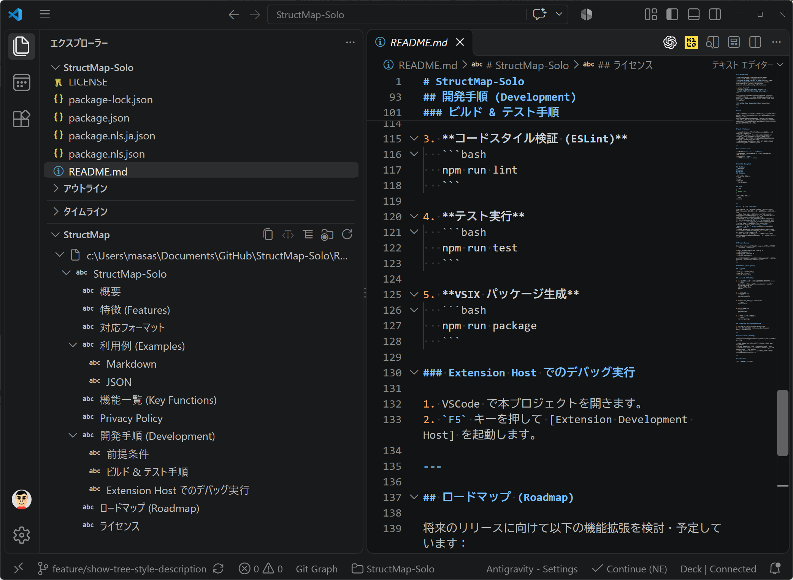

# StructMap-Solo

[](package.json)
[](https://github.com/masanori-satake/StructMap-Solo/releases)

<p align="center">
  
</p>

StructMap-Solo は、Markdown、JSON、YAML ファイルのドキュメント構造・階層構造をサイドバー（Explorer View）で直感的に可視化する Visual Studio Code 拡張機能です。



---

## 概要

ドキュメントや設定ファイルが大規模化・複雑化すると、全体構造の把握や特定のノード・見出しへのアクセスが困難になります。
**StructMap-Solo** は、エディタで開いているファイルをリアルタイムに解析し、アウトラインやオブジェクトのツリー構造を対話的に表示・操作できるようにすることで、この課題を解決します。

---

## 特徴 (Features)

- **Local First**: すべての解析・描画処理がローカル環境で完了します。
- **Privacy First**: テレメトリや外部接続を行わず、データのプライバシーを完全に保護します。
- **No AI**: AI 機能を使用せず、高速かつ正確で決定論的な構造可視化を提供します。
- **No External Services**: 外部 API やクラウドサービスへの依存は一切ありません。

---

## 対応フォーマット

- **Markdown** (`.md`, `.markdown`)
- **Markdown + Frontmatter** (YAML Frontmatter 付き Markdown)
- **JSON** (`.json`)
- **YAML** (`.yml`, `.yaml`)

---

## 利用例 (Examples)

### Markdown
```markdown
# Project
## Design
### Database
```
**StructMap 表示:**
```text
Project
└─ Design
   └─ Database
```

### JSON
```json
{
  "users": []
}
```
**StructMap 表示:**
```text
users []
```

---

## 機能一覧 (Key Functions)

- **TreeView (構造表示)**: エディタで開いているドキュメントの構造をリアルタイムでサイドバーに表示します。
- **Expand All / Collapse All (すべて展開・すべて集約)**: ツリーノードの一括展開・一括集約に対応（※配列要素数が `maxArrayItems` を超える場合の範囲ノード等は自動展開を制限）。
- **Copy Tree (ツリーコピー)**: 選択したノードまたはツリー全体をテキスト（ASCII または Unicode 罫線）としてクリップボードにコピーします。
- **Unicode / ASCII スタイル切り替え**: ツリー描画スタイルを Unicode 罫線（`└─`, `├─`）と ASCII 罫線（`` `-- ``, `|--`）でワンタップ切り替え可能です。
- **Type Mode (型表示トグル)**: JSON/YAML/Frontmatter のデータ型（`string`, `number`, `boolean`, `array`, `object`）の表示/非表示を切り替えられます。
- **Node Navigation (ノードジャンプ)**: ツリー内のノードをクリックすると、エディタの対応する行・位置へ即座にカーソルが移動します。
- **Auto Refresh (自動更新)**: ドキュメントの編集内容をデバウンス処理付きでリアルタイムに自動追従・再描画します。

---

## Privacy Policy

StructMap-Solo はプライバシーとデータセキュリティを第一に設計されています：

- **All processing occurs locally.**
- **No telemetry.**
- **No cloud services.**
- **No AI features.**

入力テキストや編集中のドキュメントがネットワーク経由で送信されることは絶対にありません。

---

## ロードマップ (Roadmap)

将来のリリースに向けて以下の機能拡張を検討・予定しています：

- **XML Support**: XML ドキュメントの階層構造パース・可視化
- **TOML Support**: TOML 設定ファイルの構造表示
- **Workspace Mode**: ワークスペース全体または複数ファイルの構造概要一覧表示
- **Copy Visible Tree**: 現在展開されている可視ノードのみのツリーコピー機能

---

## ライセンス

[MIT License](LICENSE)
