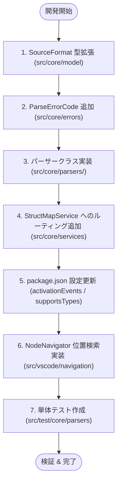

# 新規データフォーマット追加ガイド (Developer Guide)

StructMap-Solo は拡張性を考慮して設計されています。新たなデータフォーマット（例: CSV, INI 等）を追加する手順を本ドキュメントで解説します。
（※XML および TOML は現在既にコア機能としてサポートされています。以下は既存の XML パーサー等の実装を参考に拡張を行うためのウォークスルーです）

---

## 目次 (Table of Contents)

- [1. 開発フロー概要](#1-開発フロー概要)
- [2. 実装ステップ詳細](#2-実装ステップ詳細)
  - [Step 1: SourceFormat 型の追加](#step-1-sourceformat-型の追加)
  - [Step 2: ParseErrorCode の追加 (必要に応じて)](#step-2-parseerrorcode-の追加-必要に応じて)
  - [Step 3: パーサークラスの作成](#step-3-パーサークラスの作成)
  - [Step 4: StructMapService への登録](#step-4-structmapservice-への登録)
  - [Step 5: package.json のアクティベーション設定](#step-5-packagejson-のアクティベーション設定)
  - [Step 6: (任意) NodeNavigator の検索ロジック追加](#step-6-任意-nodenavigator-の検索ロジック追加)
  - [Step 7: 単体テスト (Unit Test) の作成](#step-7-単体テスト-unit-test-の作成)
- [3. 実装上の注意点・ベストプラクティス](#3-実装上の注意点・ベストプラクティス)

---

## 1. 開発フロー概要

新たなデータフォーマットを追加する際の全体フローは以下の通りです。



---

## 2. 実装ステップ詳細

ここでは例として **XML (`.xml`) フォーマット** の実装をモデルケースとした追加手順を記述します。

### Step 1: SourceFormat 型の追加
`src/core/model/index.ts` 内の `SourceFormat` 型定義に新しいフォーマット名を追加します。

```typescript
export type SourceFormat =
  | 'markdown'
  | 'json'
  | 'yaml'
  | 'xml'
  | 'jsonSchema'
  | 'toml'
  | 'csv'; // 追加例
```

### Step 2: ParseErrorCode の追加 (必要に応じて)
`src/core/errors/index.ts` の `ParseErrorCode` enum に専用のエラーコードを追加します。

```typescript
export enum ParseErrorCode {
  FILE_TOO_LARGE = 'FILE_TOO_LARGE',
  JSON_PARSE_ERROR = 'JSON_PARSE_ERROR',
  YAML_PARSE_ERROR = 'YAML_PARSE_ERROR',
  FRONTMATTER_PARSE_ERROR = 'FRONTMATTER_PARSE_ERROR',
  XML_PARSE_ERROR = 'XML_PARSE_ERROR', // 追加
  UNSUPPORTED_FORMAT = 'UNSUPPORTED_FORMAT',
  EMPTY_FILE = 'EMPTY_FILE',
}
```

また、`src/vscode/providers/StructMapTreeProvider.ts` の `getErrorDisplayLabel` に多言語対応 (l10n) ラベルのマッピングを追加します。

### Step 3: パーサークラスの作成
`src/core/parsers/xml/XmlParser.ts` を作成します。
パーサークラスは以下の原則を守る必要があります：
- 例外をスローせず、`ParseResult` (`ParseSuccess` または `ParseError`) を返す。
- オブジェクト構造の場合は `objectConverter.convertObjectToStructTree` を再利用する。

```typescript
import { createParseError, createParseSuccess, ParseErrorCode, ParseResult } from '../../errors';
import { convertObjectToStructTree } from '../common/objectConverter';

export class XmlParser {
  public parse(content: string, fileName: string, maxArrayItems: number = 50): ParseResult {
    try {
      // 1. XML 文字列を JS オブジェクト/AST にパース
      const parsedObject = parseXmlToJsObject(content);

      // 2. 共通コンバーターで StructTree に変換 (配列 chunking 対応)
      const tree = convertObjectToStructTree(parsedObject, 'xml', fileName, maxArrayItems);
      return createParseSuccess(tree);
    } catch (err: any) {
      return createParseError(
        ParseErrorCode.XML_PARSE_ERROR,
        `XML Parse Error: ${err.message || String(err)}`
      );
    }
  }
}
```

### Step 4: StructMapService への登録
`src/core/services/StructMapService.ts` にパーサーを組み込みます。

```typescript
export class StructMapService {
  private markdownParser = new MarkdownParser();
  private jsonParser = new JsonParser();
  private yamlParser = new YamlParser();
  private xmlParser = new XmlParser(); // 1. インスタンス生成

  public build(fileName: string, content: string, maxFileSizeMB: number = 5, maxArrayItems: number = 50): ParseResult {
    const ext = this.getFileExtension(fileName);
    // ...
    switch (ext) {
      case '.xml': // 2. ケース追加
        return this.xmlParser.parse(content, fileName, maxArrayItems);
      // ...
    }
  }

  private isSupportedExtension(ext: string): boolean {
    return (
      ext === '.md' || ext === '.markdown' ||
      ext === '.json' ||
      ext === '.yml' || ext === '.yaml' ||
      ext === '.xml' // 3. サポート拡張子に追加
    );
  }

  public supportsTypes(fileName?: string): boolean {
    // データ型表示 (Show Types) をサポートする場合は true に含める
    const ext = this.getFileExtension(fileName);
    return ext === '.json' || ext === '.yml' || ext === '.yaml' || ext === '.xml';
  }
}
```

### Step 5: package.json のアクティベーション設定
新規フォーマットのファイルを開いた際や言語選択時に StructMap が確実にアクティブ化するよう `package.json` の `activationEvents` やドキュメント設定を更新します。

```json
"activationEvents": [
  "onLanguage:xml"
]
```

### Step 6: (任意) NodeNavigator の検索ロジック追加
サイドバーでノードをクリックした際にエディタ内の該当行へジャンプできるよう、`src/vscode/navigation/NodeNavigator.ts` の `findNodePosition` に XML 用の位置特定ロジックを追加します。

### Step 7: 単体テスト (Unit Test) の作成
`src/test/core/parsers/XmlParser.test.ts` を作成し、以下の観点をテストします：
1. 正常系: 正しい構文のファイルが `ParseSuccess` となり正しい `StructTree` が得られるか。
2. 異常系: 構文エラーのファイルで `ParseError` (`XML_PARSE_ERROR`) が返されるか。
3. `maxArrayItems` を超える要素で範囲ノード (`isRange`) が正しく生成されるか。

---

## 3. 実装上の注意点・ベストプラクティス

1. **`src/core` における VSCode API インポート禁止**:
   - `src/core/` 配下で `import * as vscode from 'vscode'` を記述することは固く禁止されています。非依存を維持してください。
2. **Result パターンの徹底**:
   - 不正な入力や構文エラーが発生した場合でも、`throw new Error()` は使用せず、必ず `createParseError` でエラーオブジェクトを返却してください。
3. **パフォーマンス保護**:
   - `maxFileSizeMB` による事前ガードおよび配列の Chunking (`maxArrayItems`) は必ず考慮してください。
