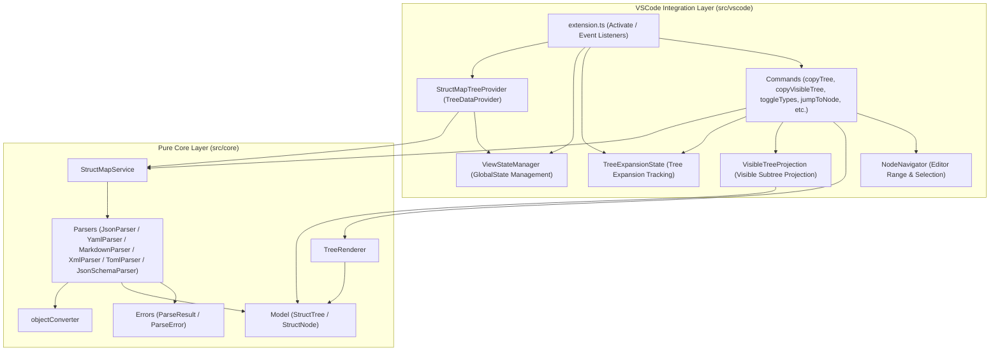
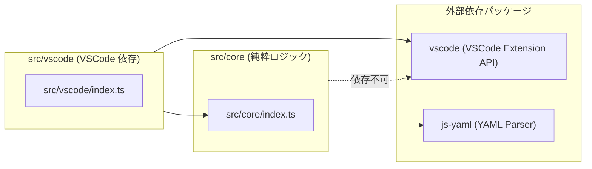

# StructMap-Solo アーキテクチャ概要

StructMap-Solo は、VSCode 上でドキュメントや設定ファイル（Markdown, JSON, YAML, XML, TOML, JSON Schema）の階層構造・アウトラインをローカル環境で高速かつ正確に可視化する拡張機能です。

本書では、StructMap-Solo の全体構造、レイヤー分離設計、各コンポーネントの役割分担、および設計思想について解説します。

---

## 目次 (Table of Contents)

- [1. 設計思想とコア原則](#1-設計思想とコア原則)
- [2. 全体レイヤー構成](#2-全体レイヤー構成)
- [3. コンポーネント役割分担](#3-コンポーネント役割分担)
- [4. コンポーネント間パッケージ依存関係](#4-コンポーネント間パッケージ依存関係)
- [5. 関連ドキュメント一覧](#5-関連ドキュメント一覧)

---

## 1. 設計思想とコア原則

StructMap-Solo は、以下の原則に基づいて設計されています：

1. **Local-First & Privacy-First**:
   - すべてのパース・描画処理は完全にローカルで完結し、外部 API 呼び出しやテレメトリ送信は一切行いません。
2. **Pure TypeScript Core (VSCode Decoupled Core)**:
   - パース処理 (`parsers`)、データモデル (`model`)、レンダラー (`renderers`)、サービス層 (`services`) を含めた `src/core/` 配下は、VSCode API に一切依存しない純粋な TypeScript モジュールとして実装されています。
   - これにより、コアロジックの単体テストが極めて容易であり、将来的に CLI や Web アプリケーションへ再利用可能な構造となっています。
3. **Unified Data Model (統一ドキュメント木)**:
   - 元のフォーマット（Markdown, JSON, YAML 等）に依存せず、すべてのファイルを統一データモデル `StructTree` / `StructNode` に変換して扱います。
4. **Deterministic & Safe Parsing (決定論的・安全性)**:
   - パース処理は例外 (`throw`) を外部に漏らさず、安全な `ParseResult` (`ParseSuccess` / `ParseError`)Result型パターンを返却します。

---

## 2. 全体レイヤー構成

StructMap-Solo は大きく **Core レイヤー (`src/core`)** と **VSCode Integration レイヤー (`src/vscode`)** の2層構造に分離されています。

---

## 3. コンポーネント役割分担

各コンポーネントの責任と役割は以下のように明確に整理されています。

| コンポーネント | レイヤー | 主要なクラス / モジュール | 主な役割・機能 |
| :--- | :--- | :--- | :--- |
| **Service** | Core | `StructMapService` | 統一パースエントリポイント。拡張子判定、ファイルサイズ上限チェック、パースルーティングを担当。 |
| **Parsers** | Core | `JsonParser`, `YamlParser`, `MarkdownParser`, `XmlParser`, `TomlParser`, `JsonSchemaParser` | 各フォーマットの文字列を解析し、`StructTree` を生成する。例外をスローせず `ParseResult` を返却。 |
| **Frontmatter Parser**| Core | `FrontmatterParser` | Markdown 先頭の YAML Frontmatter 文字列を解析し、`StructNode[]` を返却。内部例外は呼び出し元の `MarkdownParser` で捕捉され `ParseResult` へ変換。 |
| **Common Converter**| Core | `objectConverter` | JS オブジェクトから `StructNode` 木への共通変換ロジック。配列の chunking（範囲ノード `isRange`）に対応。 |
| **Model** | Core | `StructTree`, `StructNode`, `NodeType`, `ValueType` | 各種ドキュメント構造を表現する統一データ型定義。 |
| **Errors** | Core | `ParseResult`, `ParseError`, `ParseErrorCode` | 安全なパース結果表現（Result パターン）。 |
| **Renderers** | Core | `TreeRenderer`, `RenderOptions` | `StructTree` を ASCII / Unicode テキスト（罫線木）に整形・レンダリング。 |
| **TreeProvider** | VSCode | `StructMapTreeProvider` | VSCode の `TreeDataProvider` 実装。`StructMapService` の結果を `StructTreeItem` に変換しサイドバーへ提供。 |
| **Navigator** | VSCode | `NodeNavigator` | `StructNode` のパスをもとにアクティブエディタ内の対象位置（Range）を特定し、カーソル移動・ジャンプを実現。 |
| **ViewState** | VSCode | `ViewStateManager` | 型表示トグル、ルート表示、Unicode/ASCII スタイルなどの表示設定状態の管理・永続化 (`globalState`)。 |
| **ExpansionState** | VSCode | `TreeExpansionState` | TreeView 上でユーザーが展開/折りたたんだノード ID のメモリ内状態追跡（非永続化）。 |
| **Projection** | VSCode | `VisibleTreeProjection` | `StructTree` と `TreeExpansionState` のスナップショットをもとに、折りたたまれたノード自体は残してその子要素を除外させ、ルートおよび葉ノードを常に残した可視ツリーを投影生成。 |
| **Commands** | VSCode | `registerCommands` | サイドバーのボタンやコマンドパレットからの操作（コピー、可視ツリーコピー、トグル、リフレッシュ等）のハンドラ登録。 |

---

## 4. コンポーネント間パッケージ依存関係

`src/core` は `vscode` パッケージをインポートすることを硬く禁止しています。一方、`src/vscode` は `src/core` を呼び出してドキュメント構造を取得・レンダリングします。

---

## 5. 関連ドキュメント一覧

機能領域ごとの詳細な設計情報については、以下の各ドキュメントを参照してください。

1. **[データフローとイベントシーケンス](DATA_FLOW_AND_EVENTS.md)**
   - 起動時、ファイル切り替え時、リアルタイム編集時（デバウンス）、ノードジャンプ・トグル等の各種ユースケース別シーケンス図。
2. **[データモデルとパーサー・レンダラー仕様](DATA_MODEL_AND_PARSERS.md)**
   - `StructTree` / `StructNode` / `ParseResult` の型定義詳細、各パーサーの実装仕様、`TreeRenderer` の出力仕様および比較表。
3. **[新規データフォーマット追加ガイド](ADDING_NEW_FORMAT.md)**
   - XML や TOML などの新たなフォーマットを StructMap-Solo に追加実装するための開発者向けステップバイステップガイド。
4. **[ViewState と VSCode 拡張機能連携](VIEWSTATE_AND_CONFIG.md)**
   - 表示状態管理（ViewState）、VSCode 設定（`structMap.*`）、コマンドおよび UI 連携（`TreeDataProvider` / `contextKey`）の仕様。
