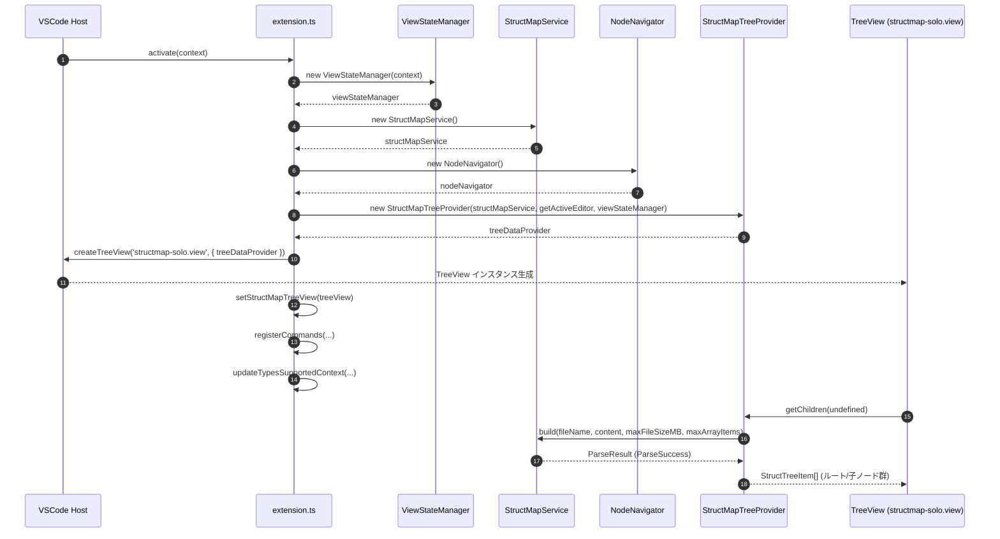
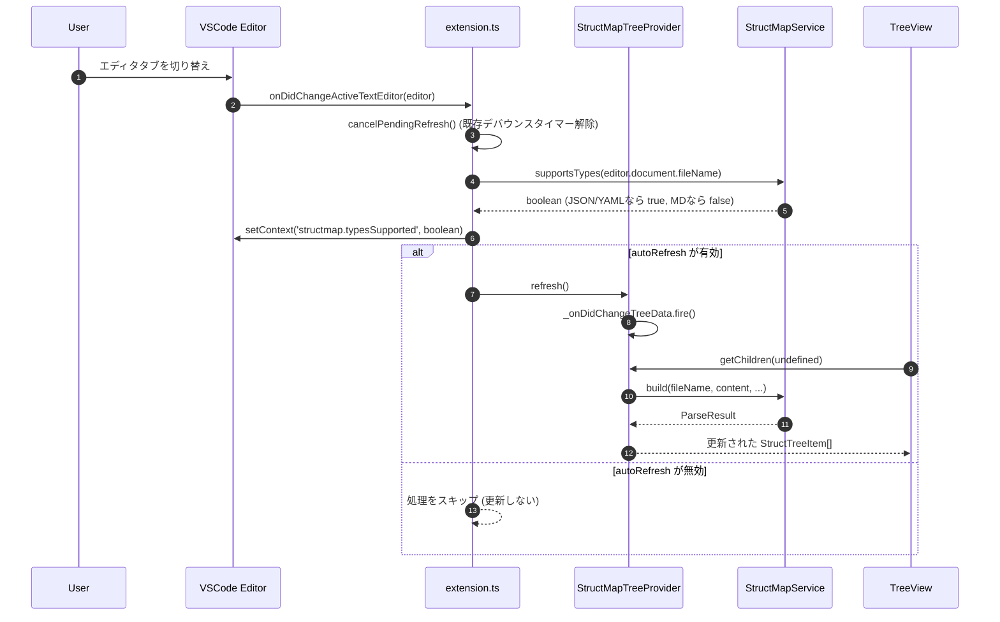
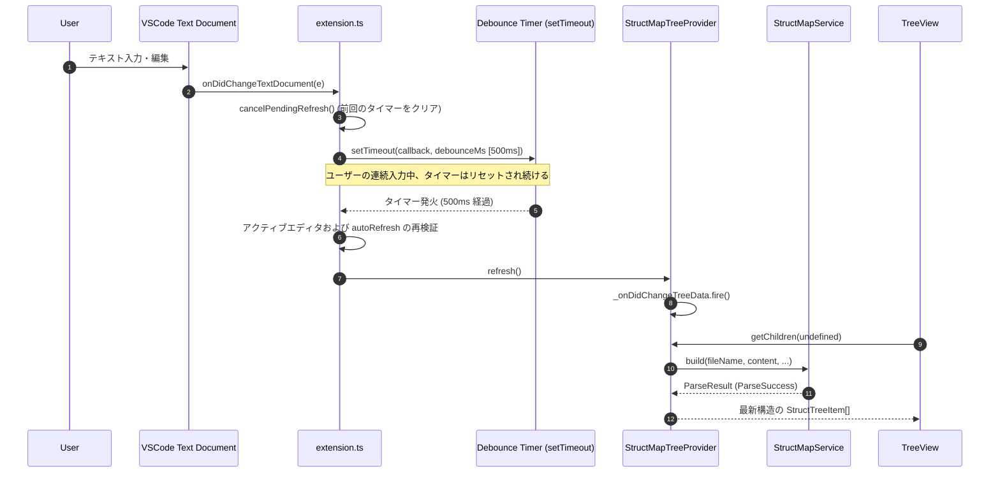
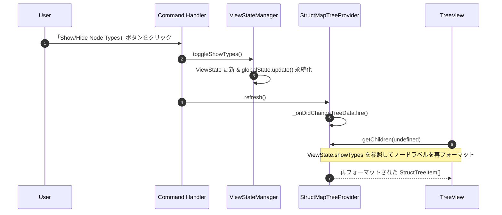
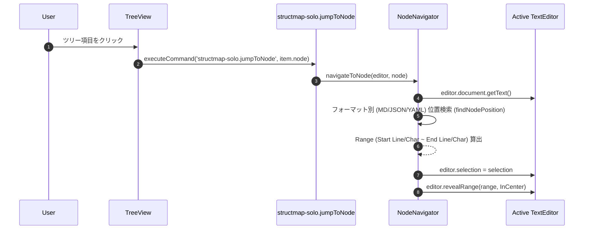
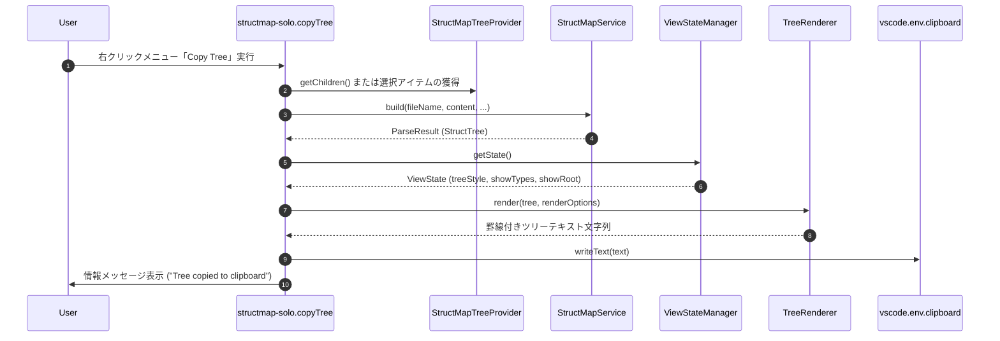

# データフローとイベントシーケンス

StructMap-Solo では、VSCode のイベントリスナー（エディタ切り替え、文書変更等）とサイドバー UI（TreeView）、コアサービス（`StructMapService`）が連動して動作します。

本ドキュメントでは、実際の操作や環境変化によって発生するイベント（ユースシーン）ごとのデータフローとシーケンスについて解説します。

---

## 目次 (Table of Contents)

- [ユースケース一覧](#ユースケース一覧)
- [UC-1: 拡張機能起動時および初期描画](#uc-1-拡張機能起動時および初期描画)
- [UC-2: アクティブエディタ切り替え時 (onDidChangeActiveTextEditor)](#uc-2-アクティブエディタ切り替え時-ondidchangeactivetexteditor)
- [UC-3: ドキュメント編集時 (onDidChangeTextDocument & Debounce)](#uc-3-ドキュメント編集時-ondidchangetextdocument--debounce)
- [UC-4: 表示オプション変更時 (型表示 / スタイル / ルート表示トグル)](#uc-4-表示オプション変更時-型表示--スタイル--ルート表示トグル)
- [UC-5: ツリーノードクリックによるエディタジャンプ (jumpToNode)](#uc-5-ツリーノードクリックによるエディタジャンプ-jumptonode)
- [UC-6: ツリー構造のテキストコピー (copyTree)](#uc-6-ツリー構造のテキストコピー-copytree)

---

## ユースケース一覧

| ID | ユースシーン | トリガーイベント / コマンド | 主な処理概要 |
| :--- | :--- | :--- | :--- |
| **UC-1** | **拡張機能起動時** | `activate(context)` | サービス初期化、`TreeDataProvider` 登録、ビュー生成、状態復元 |
| **UC-2** | **エディタ切り替え時** | `vscode.window.onDidChangeActiveTextEditor` | contextKey (`structmap.typesSupported`) 更新、自動更新設定確認、ツリー再描画 |
| **UC-3** | **ファイル編集時** | `vscode.workspace.onDidChangeTextDocument` | デバウンスタイマー (既定 500ms) 制御、タイマー発火後のツリー再描画 |
| **UC-4** | **表示トグル操作時** | `structmap-solo.toggleTypes` 等 | ViewState 更新 (`globalState` 永続化)、`refresh()` 発火による UI 再描画 |
| **UC-5** | **ノードクリック時** | `structmap-solo.jumpToNode` | ノードのパスをもとにエディタ内検索、対象位置 (Range) へカーソル移動・ハイライト |
| **UC-6** | **ツリーコピー時** | `structmap-solo.copyTree` | 全体/選択ノードを `TreeRenderer` でテキスト（Unicode/ASCII 罫線）化しクリップボードに保存 |

---

## UC-1: 拡張機能起動時および初期描画

VSCode が拡張機能をロードした際、各コンポーネントのインスタンスを生成し、`TreeView` を初期化します。

---

## UC-2: アクティブエディタ切り替え時 (onDidChangeActiveTextEditor)

ユーザーがタブを切り替えてアクティブなエディタを変更した際のデータフローです。タイマーのキャンセル、データ型サポート状況のコンテキスト更新、およびツリー再描画を行います。

---

## UC-3: ドキュメント編集時 (onDidChangeTextDocument & Debounce)

ファイル編集時、タイピングのたびにパースが走るのを防ぐため、デバウンス処理（デフォルト 500ms）を挟んでツリーを自動更新します。

---

## UC-4: 表示オプション変更時 (型表示 / スタイル / ルート表示トグル)

サイドバーのタイトルバーコマンド（例: 型表示トグル `structmap-solo.toggleTypes`）が押下された際のシーケンスです。

---

## UC-5: ツリーノードクリックによるエディタジャンプ (jumpToNode)

サイドバーの任意のノードをクリックした際、`NodeNavigator` がアクティブエディタ内をスキャンし、対象行へカーソルを移動・ハイライトします。

---

## UC-6: ツリー構造のテキストコピー (copyTree)

選択したノードまたはツリー全体をテキストとしてクリップボードへコピーする処理です。

