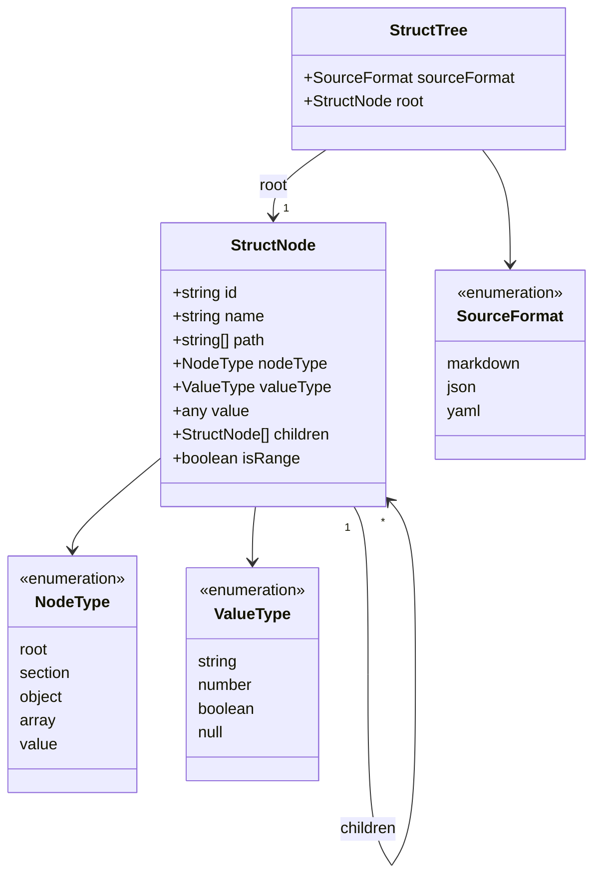
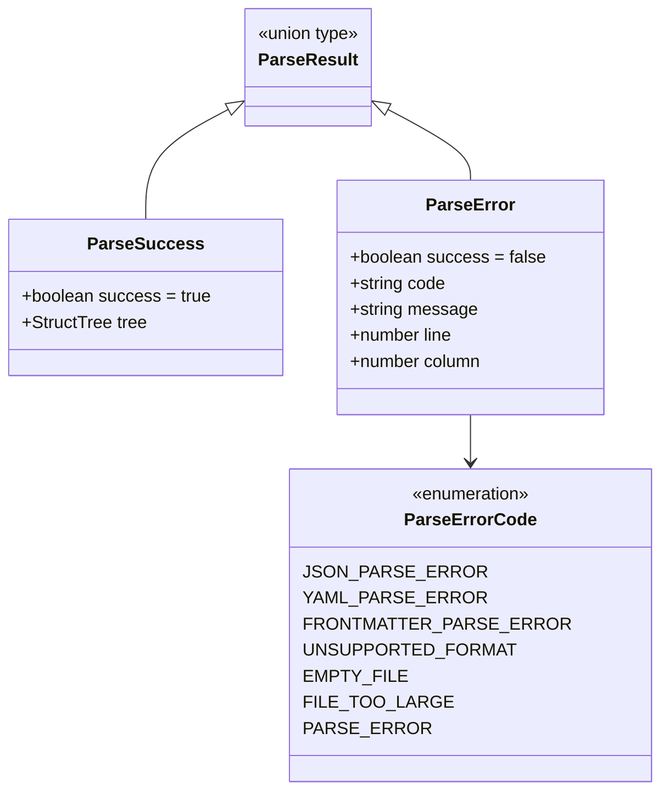
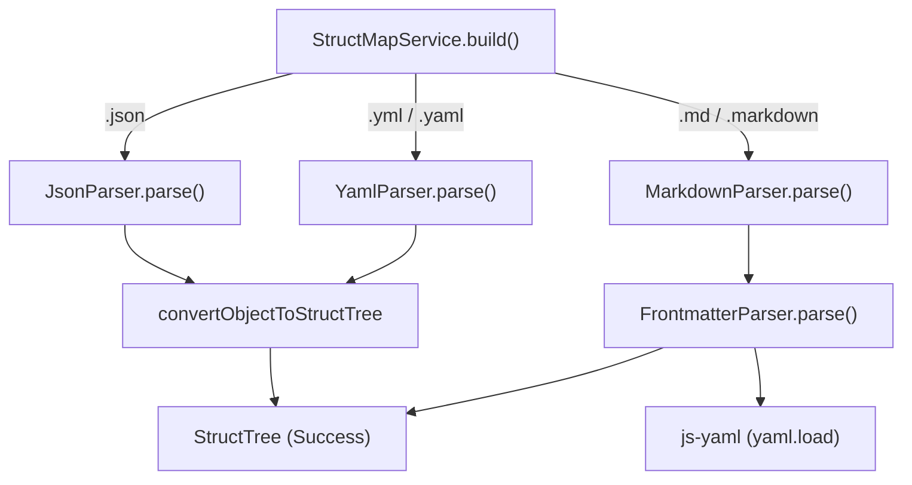

# データモデルとパーサー・レンダラー仕様

本ドキュメントでは、StructMap-Solo のコアモジュール (`src/core`) で使用されている統一データモデル、パース結果エラーハンドリング、各フォーマット用パーサー、およびテキストレンダラーの仕様について解説します。

---

## 目次 (Table of Contents)

- [1. 統一データモデル (StructTree & StructNode)](#1-統一データモデル-structtree--structnode)
- [2. パース結果とエラーハンドリング (ParseResult)](#2-パース結果とエラーハンドリング-parseresult)
- [3. パーサー構成と処理仕様](#3-パーサー構成と処理仕様)
- [4. 配列要素の Chunking 制御 (objectConverter)](#4-配列要素の-chunking-制御-objectconverter)
- [5. レンダラー仕様 (TreeRenderer)](#5-レンダラー仕様-treerenderer)
- [6. フォーマット別対応機能対照表](#6-フォーマット別対応機能対照表)

---

## 1. 統一データモデル (StructTree & StructNode)

StructMap-Solo は、任意のドキュメント（Markdown, JSON, YAML）を統一されたツリー構造 `StructTree` に変換して保持・操作します。



### StructNode プロパティ詳細仕様

| プロパティ名 | 型 | 必須 | 説明・用途 |
| :--- | :--- | :---: | :--- |
| `id` | `string` | Yes | ツリー内で一意の識別子（`path.join('.')` や H2 見出し名等から生成）。VSCode TreeItem の id として利用。 |
| `name` | `string` | Yes | ノードの表示ラベル（プロパティキー名、見出し名、または配列インデックス `[0]` 等）。 |
| `path` | `string[]` | Yes | ドキュメントルートからのノード階層パス。エディタ内ナビゲーション (`NodeNavigator`) にて位置特定に使用。 |
| `nodeType` | `NodeType` | Yes | 構造的カテゴリ（`root`, `section`, `object`, `array`, `value`）。 |
| `valueType` | `ValueType` | No | `nodeType === 'value'` の場合の不変データ型（`string`, `number`, `boolean`, `null`）。 |
| `value` | `string \| number \| boolean \| null` | No | `nodeType === 'value'` の場合のスカラー値。TreeView の `description` やホバー表示に利用。 |
| `children` | `StructNode[]` | Yes | 子ノード要素の配列（子がない場合は空配列 `[]`）。 |
| `isRange` | `boolean` | No | 配列要素数が `maxArrayItems` を超えた場合に自動生成される範囲ノード（例: 120件の配列で `maxArrayItems = 50` の場合、残りをまとめる `[50 .. 119]`）を示すフラグ。 |

---

## 2. パース結果とエラーハンドリング (ParseResult)

外部との公開境界となる各パーサーの公開メソッド（`JsonParser.parse`, `YamlParser.parse`, `MarkdownParser.parse`, および `StructMapService.build`）では、呼び出し元へ例外 (`throw`) を外部に漏らさず、安全な **Result パターン** (`ParseSuccess` | `ParseError`) を返却します。

内部で利用される `convertObjectToStructTree` や `FrontmatterParser.parse` などの内部ヘルパーは循環参照やノード数上限超過時に例外をスローするため、各パーサーの公開境界内にて `try...catch` で捕捉し、適切な `ParseError` に変換します。



### エラーコードと発生条件

| ParseErrorCode | 説明・発生条件 | UI表示ラベル (l10n対応) |
| :--- | :--- | :--- |
| `FILE_TOO_LARGE` | 設定上限 (`structMap.maxFileSizeMB`) を超過した場合 | File Too Large |
| `EMPTY_FILE` | ファイルが空または空白のみの場合 | Empty File |
| `UNSUPPORTED_FORMAT` | サポート外の拡張子の場合 | Unsupported Format |
| `JSON_PARSE_ERROR` | `JSON.parse` 構文エラー発生時 | JSON Parse Error |
| `YAML_PARSE_ERROR` | `js-yaml` 構文エラー発生時 | YAML Parse Error |
| `FRONTMATTER_PARSE_ERROR` | YAML Frontmatter の構文エラー時 | Frontmatter Parse Error |
| `PARSE_ERROR` | 一般的な構造解析エラー発生時 | Parse Error |

---

## 3. パーサー構成と処理仕様

各フォーマット用のパーサーは `src/core/parsers/` 配下に配置されています。



### 各パーサーの概要

1. **`JsonParser`**:
   - `JSON.parse` を実行し、生成された JavaScript オブジェクトを `convertObjectToStructTree` に渡して `StructTree` に変換します。
2. **`YamlParser`**:
   - `js-yaml` パッケージの `yaml.load()` を使用してオブジェクト化し、`convertObjectToStructTree` で変換します。
3. **`MarkdownParser`**:
   - 行単位でテキストを走査し、`#` の数（H1〜H6）に基づいてスタック構造で階層木をビルドします。
   - 先頭の Frontmatter (YAML) を検出した場合は、`FrontmatterParser` を呼び出して Frontmatter 構造をツリーの先頭ノードに統合します。
4. **`FrontmatterParser`**:
   - `---` で囲まれた Frontmatter 文字列を取り出し、`js-yaml` (`yaml.load()`) を直接使用して解析・オブジェクト化し、その結果を `Frontmatter (YAML)` セクションノードとして挿入します。

---

## 4. 配列要素の Chunking 制御 (objectConverter)

巨大な配列データ（例: 10,000 件のリスト）が解析された際、サイドバー描画のパフォーマンス低下を防止するため、`objectConverter` は先頭 `maxArrayItems` 件 (既定 50) を `[0]` から始まる個別ノードとして配置し、残りを単一の**範囲ノード (`isRange: true`)** にまとめます。

```text
[元の巨大な配列: 120件、maxArrayItems = 50]
  └─ items
      ├─ [0]
      ├─ [1]
      ├─ ...
      ├─ [49]
      └─ [50 .. 119] (isRange: true)
```

---

## 5. レンダラー仕様 (TreeRenderer)

`TreeRenderer` は、生成された `StructTree` をテキスト罫線によるツリー表現に変換します。「Copy Tree」機能等で利用されます。

### RenderOptions パラメータ

- `showTypes` (`boolean`): 型情報 (`: string`, `: object` 等) を付与するかどうか。
- `showRoot` (`boolean`): ルートノード自体を出力に含めるかどうか。
- `treeStyle` (`'unicode' | 'ascii'`): 罫線文字セットの選択。

### 罫線文字セットの違い

| treeStyle | 子ノード分岐 | 最終子ノード | インデント継続 |
| :--- | :---: | :---: | :---: |
| `'unicode'` | `├─ ` | `└─ ` | `│  ` |
| `'ascii'` | `+- ` | `+- ` | `\|  ` |

---

## 6. フォーマット別対応機能対照表

| 機能・特性 | Markdown | JSON | YAML |
| :--- | :---: | :---: | :---: |
| **ソースフォーマット識別名** | `markdown` | `json` | `yaml` |
| **型表示 (Show Types) サポート** | No (見出し構造) | Yes (`object/array/value`) | Yes (`object/array/value`) |
| **Frontmatter 解析** | Yes (YAML Frontmatter) | N/A | N/A |
| **配列 Chunking (maxArrayItems)** | N/A | Yes | Yes |
| **エディタジャンプ (`NodeNavigator`)** | 見出し文字列検索 | JSONポインタ/キー検索 | YAMLキー/インデント検索 |
| **データ構造の種類** | `section` 中心 | `object` / `array` / `value` | `object` / `array` / `value` |
