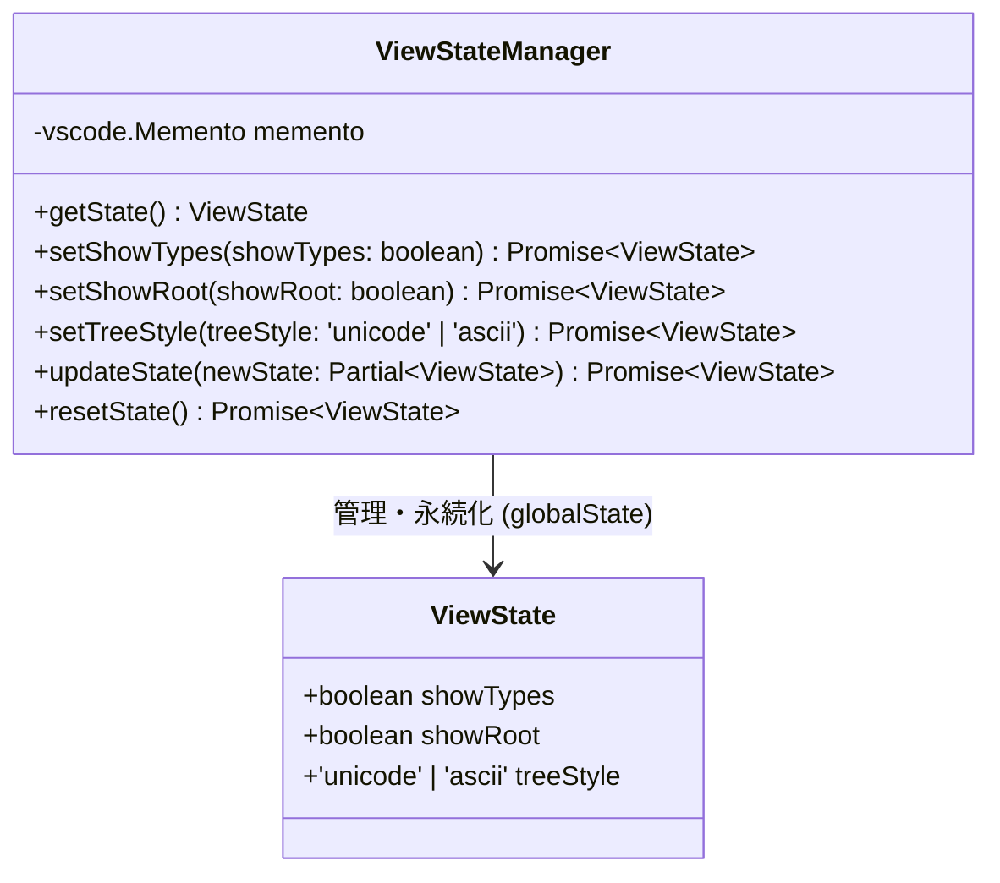
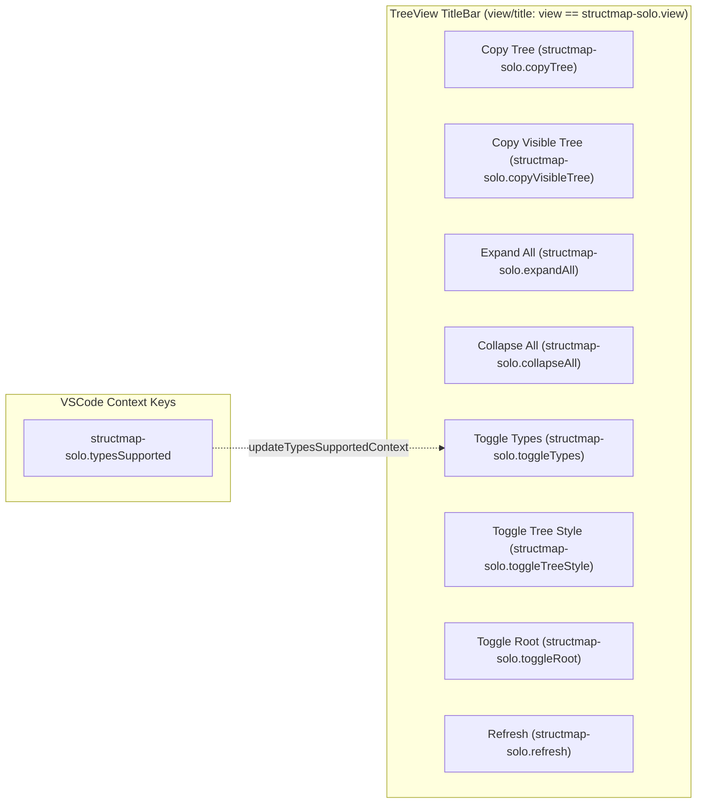
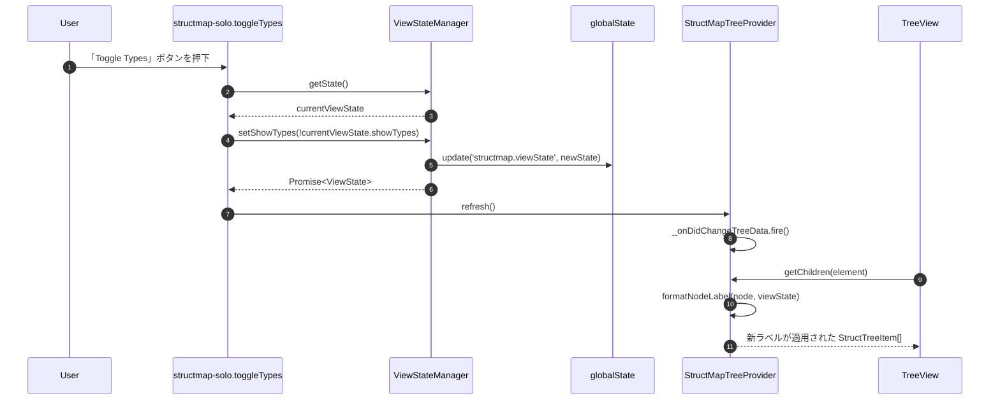

# ViewState と VSCode 拡張機能連携仕様

本ドキュメントでは、表示設定の状態管理 (`ViewStateManager`)、VSCode 設定項目 (`structMap.*`)、および VSCode UI (TreeView / Context Keys / Titlebar Commands) との連携仕様について解説します。

---

## 目次 (Table of Contents)

- [1. 表示状態管理 (ViewState)](#1-表示状態管理-viewstate)
- [2. VSCode 拡張機能設定 (Configuration)](#2-vscode-拡張機能設定-configuration)
- [3. UI コマンドと Context Key 連携](#3-ui-コマンドと-context-key-連携)
- [4. ViewState と TreeView の連動シーケンス](#4-viewstate-と-treeview-の連動シーケンス)

---

## 1. 表示状態管理 (ViewState)

ビューの表示オプション（型情報の表示、ルートノード表示、罫線スタイル）は `ViewState` インターフェースで管理され、`ViewStateManager` により `context.globalState`（キー名: `structmap.viewState`）へ永続化されます。

### ViewState 型定義

```typescript
export interface ViewState {
  showTypes: boolean;              // ノードデータ型表示トグル (既定: true)
  showRoot: boolean;               // ルートノード表示トグル (既定: true)
  treeStyle: 'unicode' | 'ascii';  // 罫線描画スタイル (既定: 'unicode')
}
```



---

## 2. VSCode 拡張機能設定 (Configuration)

`package.json` の `contributes.configuration` で公開されているユーザー設定項目一覧です。設定変更はリアルタイムにエディタの再パース・挙動に反映されます。

| 設定キー | 型 | 既定値 | 説明 |
| :--- | :---: | :---: | :--- |
| `structMap.autoRefresh` | `boolean` | `true` | エディタ変更時に自動でサイドバーのツリーを更新するかどうか。 |
| `structMap.debounceMs` | `number` | `500` | 自動更新時のデバウンス時間 (ミリ秒)。入力中の負荷を軽減します。 |
| `structMap.maxFileSizeMB` | `number` | `5` | パース対象とする最大ファイルサイズ (MB)。超過した場合は `FILE_TOO_LARGE` エラーを表示。 |
| `structMap.maxArrayItems` | `number` | `50` | 配列要素を個別に表示する最大件数。超過時は Chunking ノード (`[1 .. 50]`) を展開生成。 |
| `structMap.customMappings` | `object` | `{"*.toml": "toml"}` | ファイル名のグロブパターンとフォーマット（json, yaml, xml, toml, jsonschema, markdown）の紐付け設定。 |

※`structMapSolo.customMappings` も後方互換性のため併せてサポートされています。

---

## 3. UI コマンドと Context Key 連携

サイドバーのタイトルバーおよびメニューには、各種トグルコマンドが配置されています。



### コマンドと表示制御の連動

- **タイトルバーコマンドの配置・条件**:
  - タイトルバーに表示されるボタン群は `package.json` の `"when": "view == structmap-solo.view"` 条件により `structmap-solo.view` のタイトルバーに配置されます。
- **`structmap-solo.typesSupported` (Context Key)**:
  - アクティブエディタがデータ型表示に対応しているフォーマット（JSON, YAML, XML, TOML, JSON Schema）の場合、またはカスタムマッピングでこれらに該当する場合に `true` がセットされます。
  - `structmap-solo.toggleTypes` コマンドハンドラ内にて、アクティブ文書がデータ型非対応（Markdown 等）の場合はトグル処理を実行しないようガードします。
- **TreeView View Description**:
  - `treeView.description` に現在のツリースタイル（例: `Style: Unicode` または `Style: ASCII`）がリアルタイム表示されます。

---

## 4. ViewState と TreeView の連動シーケンス

表示オプションがトグル変更された際、`ViewStateManager` の `set*` メソッドが呼び出されて新しい状態を永続化し、`StructMapTreeProvider.refresh()` を呼び出すことで `StructTreeItem` のラベルフォーマットが再適用されます。


